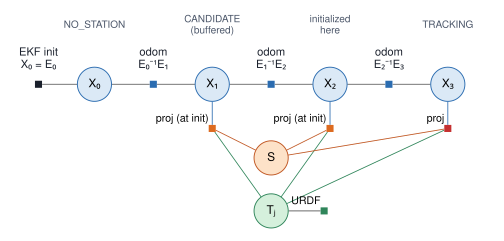

# Factor Graph (race_auv_factorgraph)

One tag j, four keyframes, through initialization. Circles are variables (solved for); squares are factors (constraints on the variables they connect).

- <i>X</i>0: no tag in view (NO_STATION). Odometry only.
- <i>X</i>1: tag j seen, but the station is not known yet (CANDIDATE). The frame is only **buffered** (PnP hypotheses for the initializer); no projection factor yet, because <i>S</i> does not exist.
- <i>X</i>2: tag j seen again, and the initializer accepts. One smoother update then inserts <i>S</i>, <i>T</i>j with its URDF prior, and the projection factors of **all** buffered frames, <i>X</i>1's and <i>X</i>2's (orange: "at init").
- <i>X</i>3: TRACKING. Its projection factor goes in at its own keyframe (red).

(The real initializer waits for more frames and checks that their PnP hypotheses agree, §7 of [DOCK_FUSER_PIPELINE.md](DOCK_FUSER_PIPELINE.md); two frames keep the picture small.)

## Where each symbol lives

All variables live in the **graph frame**, which the node publishes as `odom_graph`. It is fixed to the tank: the station does not move in it. The EKF's `odom` coincides with it at the first keyframe (the EKF init factor) and drifts away from it afterwards; TF `odom → odom_graph` is that drift, <i>E</i>k<i>X</i>k−1.

| Symbol | Solved? | Pose of … in … | In ROS |
|---|---|---|---|
| <i>E</i>k | no, measured (EKF input) | `base_link` in `odom` | TF `odom → base_link`, `/race_auv/odometry/filtered` |
| <i>X</i>k | yes | `base_link` in the graph frame | `~/odometry` (`odom_graph → base_link`, 20 Hz: the latest <i>X</i>k moved by the EKF since) |
| <i>S</i> | yes | `dock_point` in the graph frame | TF `odom_graph → race_station/base_link` (= <i>S</i>·<i>T</i>dock→base), `~/dock_pose` |
| <i>T</i>j | yes | tag j in `dock_point` | TF `race_station/dock_point → tag frame` |
| <i>T</i>bc | no, fixed (AUV URDF) | camera optical frame in `base_link` | TF `base_link → cam_front` (URDF) |

<i>E</i>k is not a circle in the figure: it is the measurement inside the EKF init and odom factors, as their labels show.

## Factors

| Symbol | Kind | Connects | Meaning |
|---|---|---|---|
| **EKF init** (black) | factor | <i>X</i>0 | <i>X</i>0 = <i>E</i>0, σ = 10−4 (rad, m). Added once. Ties the graph frame to `odom` at the first keyframe, so `odom_graph` = `odom` there. |
| **odom** (blue) | factor | <i>X</i>k−1, <i>X</i>k | EKF motion <i>E</i>k−1−1<i>E</i>k, all 6 DOF. Relative only, because the EKF's absolute pose drifts. Random-walk σ (grows with time and distance); extra translation σ while the DVL has no bottom lock. Huber, k = 3. |
| **proj** (red; orange if inserted at initialization) | factor | <i>X</i>k, <i>S</i>, <i>T</i>j | One sighting of tag j: its 4 corner pixels vs. the corners of <i>S</i>·<i>T</i>j projected into the camera at <i>X</i>k·<i>T</i>bc (8 rows). σ = 1 px, Huber, k = 2. |
| **URDF** (green) | factor | <i>T</i>j | <i>T</i>j near its station-URDF pose; σ = mounting tolerance (2°, 1 cm). Added once per tag, when the tag first enters the graph. |

The proj residual, for corner i of tag j (<i>c</i>i on the tag, <i>uv</i>i detected, π the pinhole projection with the camera matrix <i>K</i>):

  π(<i>K</i>, (<i>X</i>k·<i>T</i>bc)−1·<i>S</i>·<i>T</i>j·<i>c</i>i) − <i>uv</i>i

In words: the tag reached through the station (<i>S</i>·<i>T</i>j) must land where the camera on the AUV (<i>X</i>k·<i>T</i>bc) saw it.

<i>T</i>j hangs off <i>S</i> geometrically: it is tag j's pose in the `dock_point` frame, starting at (and held near) the station URDF. That is why it is drawn under <i>S</i>. But no factor connects the two, so there is no edge: they meet only inside each proj factor, as the product <i>S</i>·<i>T</i>j (tag j's pose in the graph frame). The URDF factor holds <i>T</i>j alone, not <i>S</i>·<i>T</i>j. See [DOCK_FUSER_PIPELINE.md](DOCK_FUSER_PIPELINE.md); figure source [graphs/example/factor_graph.dot](graphs/example/factor_graph.dot).
