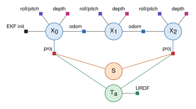
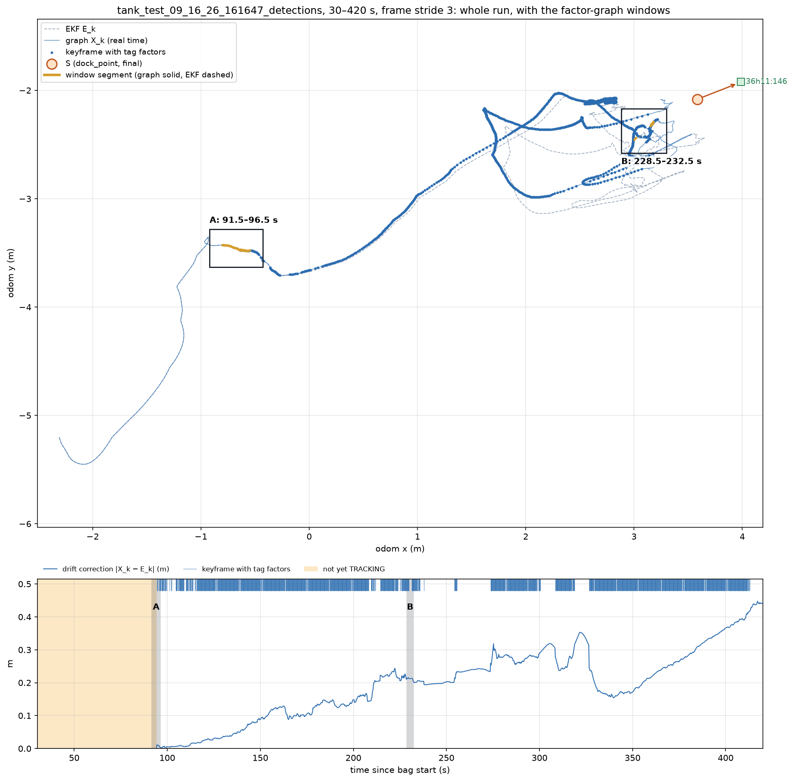
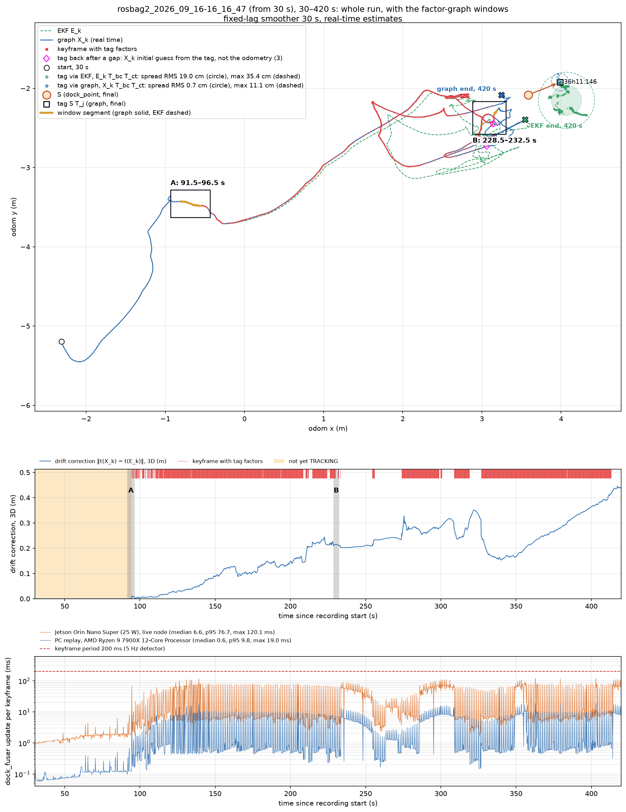
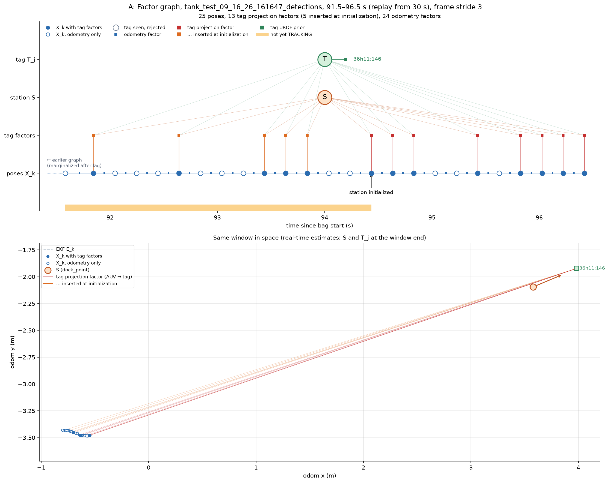
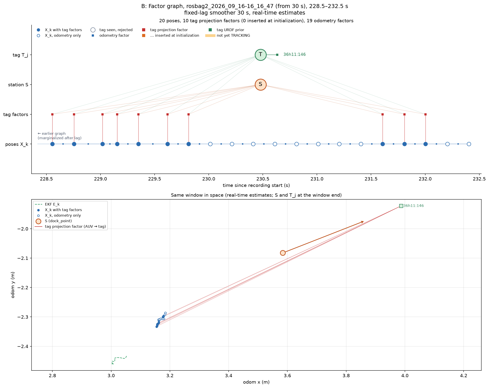
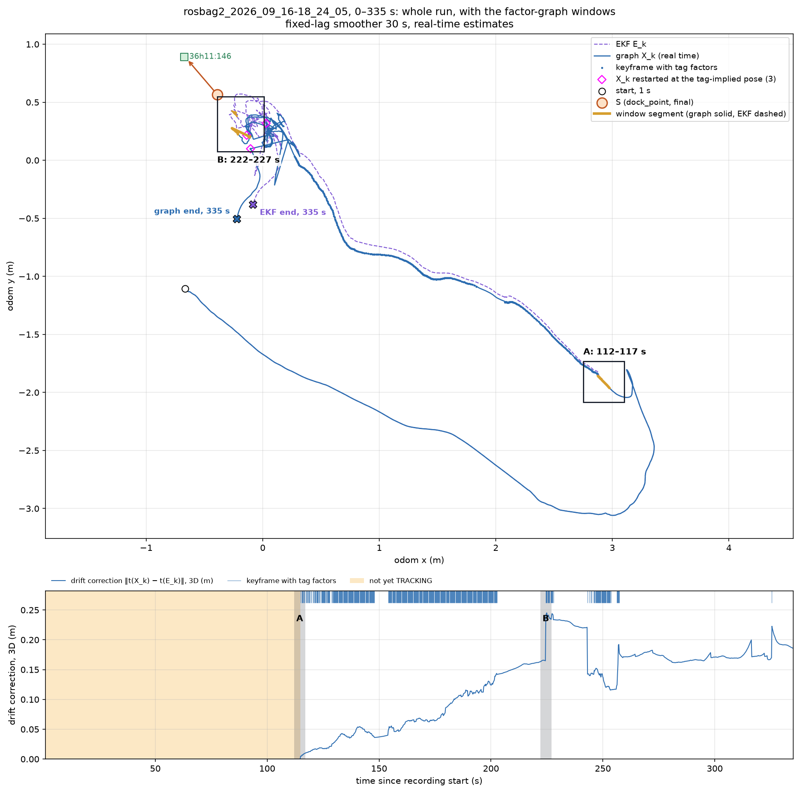
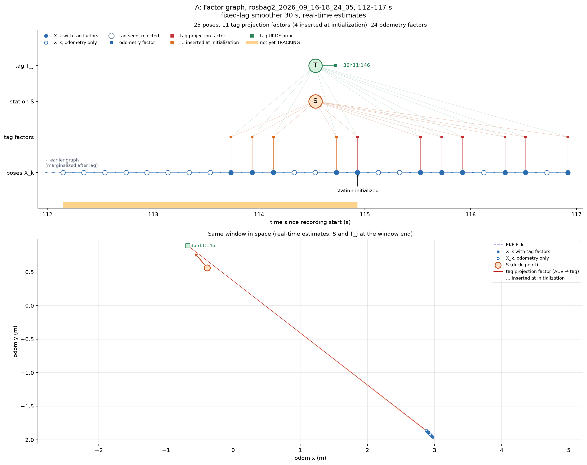
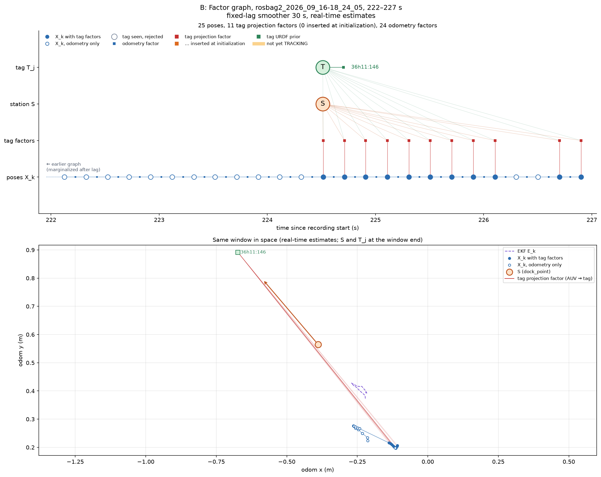

# Dock Fuser: gtsam Pipeline

This document describes the factor-graph pipeline that estimates the docking station's pose from AprilTag corner detections and the `robot_localization` EKF odometry. It is implemented as a Python ROS 2 node using gtsam's fixed-lag smoother (iSAM2 with marginalization).

---

## 1. Overview

```
 /odometry/filtered ──► EKF pose buffer ───────────────┐   (interpolate E(t) at any stamp)
 cam_front corners  ──► detection queue ───────────────┤   (one keyframe per detector message)
                                                       ▼
                                            ┌─────────────────────┐
                                            │  Keyframe manager   │
                                            └──────────┬──────────┘
                                                       ▼
                          ┌──────────── Factor builders ────────────┐
                          │  odometry · tags                        │
                          └────────────────────┬─────────────────────┘
                                               ▼
                        Station state (NO_STATION / CANDIDATE / TRACKING)
                                               ▼
                                    fixed-lag smoother backend
                                               ▼
                       Output: odom → station TF  +  /dock_point/pose
```

The EKF owns `odom → base_link` and drives control. The graph estimates the station's pose and publishes `odom → station`, including the correction for EKF drift (§10). The TF tree composes the two, so `base_link → dock_point` is always available at the EKF rate.

---

## 2. Conventions

| Symbol | Meaning |
|---|---|
| `odom` | Graph frame. Same as the EKF's `odom` frame. |
| `E_k` | EKF pose of `base_link` in `odom` at keyframe k, interpolated to the keyframe stamp. |
| `T_bc` | Camera extrinsic (`base_link → camera`) from the AUV URDF. Held constant. |
| `K_C` | Pinhole camera matrix of the **rectified** image for camera C, read from the node's YAML config (§3). No distortion terms. |
| `s_j` | Black-square edge length of tag j (where the detector places the corners). |
| `c_i` | Corner i of a tag in the tag frame: `(±s_j/2, ±s_j/2, 0)`. |

Camera model: the detector runs on rectified images, so corner pixels are already distortion-free. The graph uses a plain pinhole projection with `K_C`. The raw calibration is used only by the rectifier.

### Frames: what is known where

```
            odom  (origin = where robot_localization started, (0,0,0))
           /    \
   X_k    /      \   S          ← the one unknown that links the two worlds
 (EKF)   /        \
   base_link     dock_point  (station frame)
       |              |
  T_bc |              | T_j  (tag j's pose in the station frame; URDF value as prior)
       |              |
    camera ─────────► tag j
          observation
        (4 corner pixels)
```

- **AUV side, known in `odom`.** The EKF gives `X_k` (`base_link` in `odom`). `T_bc` comes from the AUV URDF. So the camera's pose in `odom` is known.
- **Station side, known in `dock_point`.** Every tag's pose `T_j` and corner layout are known in the station frame (station URDF). Nothing about the station is known in `odom`.
- **The link is `S`**, the station's pose in `odom`. It is the single unknown that connects the two sides. A tag is never placed directly in `odom`: its `odom` pose is always `S · T_j`.
- **The `odom` origin is arbitrary.** `robot_localization` starts at `(0,0,0)` wherever the AUV happens to be, and `S` simply absorbs that offset. The station ends up at some `S` in `odom`, and docking only ever uses the relative pose `X_k⁻¹ · S`.

---

## 3. Inputs

| Input | Type | Use |
|---|---|---|
| `/race_auv/odometry/filtered` | `nav_msgs/Odometry` | Pose buffer for the odometry factors. |
| `/cam_<name>/apriltag_detection/tags` | `apriltag_msgs/AprilTagDetectionArray` | Tag ID + 4 corner pixels per tag, stamped with the image time. One topic per enabled camera. Every message of the `keyframe_camera`, also an empty one, is one keyframe; the other cameras' messages with tags are attached to those keyframes (§6). Which tags each camera reports is the detector's `camera_tag_ids` (`tag_factorgraph_detector.yaml`), a subset of `station_tags.yaml`. Tag factors and initialization. |
| Node YAML config | — | `K_C` of the camera, its detection topic, tag sizes, noise parameters. |
| AUV URDF | — | `T_bc` of the camera. |
| Station URDF | — | Tag poses relative to `dock_point` (links `apriltag<family>_<id>`). |

The corner detections come from `tag_detector_node` (`race_auv_perception/race_auv_camera_tag_factorgraph`), a minimal detector made for this pipeline: rectify (cv2), detect tag36h11 (apriltag3, CPU), per-ID tag size, image checks (§8), then publish the corners on `apriltag_detection/tags` and the IPPE pose on `apriltag_detection/detections3d`, one message per processed image (also with no tags), stamped with the image time. It also latches the rectified intrinsics on `apriltag_detection/camera_info`, which is where the fuser takes its camera matrix from (see the table below). Its parameters are in `race_auv_bringup/config/tag_factorgraph_detector.yaml` (launched with the cameras and dock_fuser by `race_auv_bringup/launch/bringup_camera_tag_factorgraph.launch.py`). The older `race_auv_camera_pkg` detector publishes the same topics with the same corner order and can still be used. The corners are in the full-resolution **rectified** image, in a fixed **canonical order**: corner `i` is the image of tag-frame point

| i | tag-frame point | |
|---|---|---|
| 0 | `(-s/2, +s/2, 0)` | left-bottom |
| 1 | `(+s/2, +s/2, 0)` | right-bottom |
| 2 | `(+s/2, -s/2, 0)` | right-top |
| 3 | `(-s/2, -s/2, 0)` | left-top |

(tag frame: x right, y down, z into the tag). This is the apriltag3 `lb-rb-rt-lt` order and the order `cv2.SOLVEPNP_IPPE_SQUARE` needs, so the corners need no reordering and the detector's pose agrees with them by construction. The station URDF tag frames follow the same frame. `race_auv_camera_tag_factorgraph/test/test_tags.py` pins it on rendered tags: the detected corner `i` lands on the projection of `c_i` within 1 px. (The legacy detector's cuAprilTags backend returns its own order and reorders corners into this one, `apriltag_geom.canonical_corner_order`.) On the tank run (30–420 s, 5634 images) both detectors find the same tags with corners 0.03 px apart (median).

`s` is the edge of the **black square**, where the corners are. The sim tags are 0.15 m / 0.05 m textured boxes with a white border, so their black squares are 0.12 m / 0.04 m.

**One source for each input.** Nothing is configured twice:

| What | Single source | Used by |
|---|---|---|
| Tag IDs and sizes | `race_auv_bringup/config/station_tags.yaml` (`/**`: `tag_ids`, `tag_sizes`) | detector and fuser; their launch files pass it first |
| Tag poses on the station, `T_dock_base` | station URDF (`apriltag36h11_<id>` links) | fuser |
| Camera pose on the AUV, `T_bc` | AUV URDF | fuser |
| Raw camera calibration | `race_auv_bringup/config/tag_factorgraph_detector.yaml` | detector (rectification) |
| Rectified camera matrix | the detector's latched `apriltag_detection/camera_info` | fuser |

The fuser waits for the camera_info before processing any frame (frames queue in the scheduler meanwhile; `/diagnostics` says "waiting for camera_info"). The camera's topics and frame follow from its name, so the vehicle config only lists `camera_names: [cam_front, cam_down]` (with `keyframe_camera: cam_front`; `cameras.cam_down.enabled: false` switches a listed camera off). The offline tools read the camera_info from the bag (`bag_test.launch.py` records it), and `--config` takes several files merged in order, like the node (`--config station_tags.yaml dock_fuser.yaml`).

`cameras.<name>.fx/fy/cx/cy/width/height` in a config are an override, for inputs without camera_info: the simulation (legacy detector) and replays of older detection bags (`tank_dock_fuser.yaml`). They must be the RECTIFIED camera matrix, not the raw calibration; a mismatch scales every range estimate. When both exist, the node warns if they differ from the camera_info by more than 0.5 px.

---

## 4. Variables

| Key | Type | Lifetime | Meaning |
|---|---|---|---|
| `X_k` | `Pose3` | one per keyframe | AUV `base_link` in `odom`. |
| `S` | `Pose3` | permanent | Station `dock_point` in `odom`. The station is static, so this is one variable shared by all keyframes. |
| `T_j` | `Pose3` | permanent, created at first sighting | Pose of tag j relative to `S` (its mounting offset). |

No velocity or IMU-bias variables: the EKF already fuses IMU, DVL and pressure, and the graph only consumes its pose.

---

## 5. Factors

| Factor | Keys | Residual | Noise | Added |
|---|---|---|---|---|
| EKF init prior | `X_0` | `X_0 ⊖ E_0` | very tight | first keyframe only |
| Odometry | `X_{k-1}, X_k` | `(X_{k-1}⁻¹ X_k) ⊖ (E_{k-1}⁻¹ E_k)` | random walk (below), Huber | every keyframe |
| Tag URDF prior | `T_j` | `T_j ⊖ T_j^URDF` | `σ_mount` | once per tag, at creation |
| Tag projection | `X_k, S, T_j` | `π(K_C, (X_k · T_bc)⁻¹ · S · T_j · c_i) − uv_i` for i = 1..4 (8 rows) | 1 px per coordinate, Huber | each accepted tag observation |

### Example factor graph

Also available on its own page: [DOCK_FUSER_FACTOR_GRAPH.md](DOCK_FUSER_FACTOR_GRAPH.md).



One tag, three keyframes during an approach. `X_0` and `X_2` see tag a; `X_1` is a detector message with no tag in view.

Circles are variables (solved for); squares are factors (measurements or priors on the variables they connect to).

| Symbol | Kind | Connects | Meaning |
|---|---|---|---|
| `X_k` (blue) | variable | | AUV pose in `odom` at keyframe k. Starts at the EKF-predicted pose; tags pull it off the EKF when the EKF drifts. |
| `S` (orange) | variable | | Station `dock_point` pose in `odom`. One for the whole run (the station is static). Docking uses `X_k⁻¹ · S`. |
| `T_a` (green) | variable | | Tag a's pose on the station, relative to `S`. Stays at its URDF value while only one tag is seen. |
| `EKF init` (black) | factor | `X_0` | `X_0 = E_0`, very tight. Added once; ties the graph to `odom`. |
| `odom` (blue) | factor | `X_{k-1}`, `X_k` | EKF motion `E_{k-1}⁻¹E_k` (relative only, since x, y, yaw drift). Huber. |
| `proj` (red) | factor | `X_k`, `S`, `T_a` | One tag sighting: 4 observed corner pixels vs. corners predicted from `S · T_a` seen by the camera at `X_k · T_bc`. 1 px, Huber. |
| `URDF` (green) | factor | `T_a` | Keeps `T_a` near its station-URDF pose; σ = mounting tolerance. Added once. |

`S` and `T_a` have no direct link: the `proj` factors use them only as the product `S · T_a`, the tag's pose in `odom`.

How to read it:

- Every tag observation is one red square with three edges. All of them meet at `S`, which is how observations from different keyframes combine into one station estimate.
- The two observations are linked through the `odom` chain `X_0 – X_1 – X_2`. This is what makes single-tag initialization over several frames work (§7): the odometry says how the camera moved between the two views, and the static `S` must explain both.
- `X_1` has no projection factor. Its pose comes from odometry alone, and `S` keeps the value the observations gave it.
- With a single tag, its mounting error cannot be separated from the station pose: `S` absorbs it, and `T_a` stays at its prior. The dock point estimate is then only as accurate as that tag's URDF mounting. Additional tags work the same way: each one adds its own `T_j` with a URDF prior and its own projection factors, all meeting at the same `S`.

Source: [dock_fuser_factor_graph.dot](dock_fuser_factor_graph.dot). Re-render with `neato -n2 -Tsvg docs/dock_fuser_factor_graph.dot -o docs/dock_fuser_factor_graph.svg`.

### The real graph on the tank run

`tools/plot_graph.py` replays a bag and draws the factors the estimator actually inserted, for a few seconds at a time (the whole 30–420 s run has ~1900 poses at 5 Hz). Top: structure, with `X_k` along a time axis and `S`, `T_j` above. Bottom: the same graph in space. Tank recording `rosbag2_2026_09_16-16_16_47`, 30–420 s, with `tank_dock_fuser.yaml` (tag 146, `cam_front`), i.e. the fixed-lag smoother with a 30 s lag exactly as the node runs it. The detections were made from the recorded images by the current tag detector at 5 Hz, as on the vehicle (`bag_test.launch.py`, with the DVL recorded too). All poses shown are the **real-time** estimates (`X_k` as known at keyframe k), not re-smoothed afterwards; times are seconds into the recording. One keyframe per detector message, so the poses are evenly spaced at 0.2 s.

**Overview, 30–420 s.** Where the two windows below come from. Top: the EKF (green dashed) and the graph's real-time track (blue; red dots where the keyframe has tag factors), the final station and tag (hollow black square), every tag observation placed in odom twice, and a box around each window with its own segment highlighted (the track passes near B several times). The start (circle; the two tracks coincide there, `X_0 = E_0`) and the two end points at 420 s are marked; at the end they are ~0.44 m apart. The real-time track is continuous except at the magenta diamonds: keyframes where the tag came back after ~8 s without tags and the optimizer's starting guess for `X_k` was taken from the tag instead of the drifted odometry chain (§8, `_seed_from_tags`; nothing is reset). The drift of the gap is corrected there in one step (10–14 cm). The tag clouds chain each detection's single-image PnP pose `T_ct` onto the AUV pose: through the EKF, `E_k T_bc T_ct` (green), they smear over ~0.5 m, because the EKF drifts while the tag does not move; through the graph, `X_k T_bc T_ct` (blue), they stay on the final tag estimate. Each cloud's spread is the horizontal distance of its observations from the cloud's own mean, drawn as a transparent circle of the RMS radius and a dashed ring at the max (one outlier sets the max, so it is only an outline): EKF RMS 19.0 cm, max 35.4 cm; graph RMS 0.7 cm, max 11.2 cm (1255 observations). Bottom: the drift correction over time, the 3D distance `‖t(X_k) − t(E_k)‖` between the graph's and the EKF's AUV position (the same number as `drift_correction_m` in `/diagnostics`; independent of where the odom origin is), which grows to ~0.46 m by 420 s, a raster of keyframes with tag factors, and the windows shaded.



**Real time on the Jetson.** The same run with the tag detector and `dock_fuser` running live on the vehicle's Jetson (Orin Nano Super, 25 W mode, CPU clocks not locked), fed by the bag played from a desktop over DDS (`/clock` from the player). Both nodes kept the detector's 5 Hz: 1949 detector messages, 1948 keyframes, 0 dropped or waiting. The live estimates are identical to an offline replay of the bag recorded in that run (docking pose difference 0.0 cm over 1627 keyframes), so the top two panels show the same thing as above. The bottom panel is the per-keyframe `dock_fuser` update (the timed part of `process_keyframe`, covariance included): the live node on the Jetson (`update_ms` recorded from `/dock_fuser/keyframe`) against a replay of the same detections on the desktop. Jetson median 6.6 / p95 77 / max 120 ms, desktop 0.6 / 10 / 19 ms, about 10× apart. Before initialization only the `X` chain is solved (1–2 ms on the Jetson). The tall regular spikes start with tracking; they are most likely the relinearizations of `S`, which re-evaluate every projection factor still in the 30 s window (§9). The 200 ms keyframe period is never exceeded. The detector took a further 83–96 ms per frame in its own process, so image to docking pose was 140 ms median, 274 ms max.



**A: initialization, 91.5–96.5 s.** Before 94.6 s the station does not exist: tag frames are buffered, and the graph holds only the `X` chain (orange band); white circles are detector messages without a tag. At 94.6 s the vote and batch solve succeed, and `S`, `T_146` and the 4 buffered observations of the last ~2.6 s (orange) enter the graph in one update. From then on, each tag adds its projection factor at its own keyframe (red).



**B: blind gap, 228.5–232.5 s.** Tags in view, then ~1.8 s with none: the detector keeps publishing (empty messages), so keyframes continue at 5 Hz with odometry only (white). When the tag returns, its factors resume on the first frame. The bottom panel shows the drift correction: the graph poses (blue) sit ~0.2 m from the EKF (green dashed).



**Second run, `rosbag2_2026_09_16-18_24_05`.** Same setup, replayed from the start of the recording; the overview shows 100–210 s of it (`--view-start 100`: the estimates are those of the full replay, only the drawing is cropped), which holds the initialization (A) and the approach. Through the EKF the tag observations spread 4.3 cm RMS (max 11.6 cm), through the graph 0.7 cm RMS (max 6.3 cm), 395 observations. The station is initialized at 114.9 s (A, 4 buffered observations). After a 22 s stretch without tags (202.7–224.5 s), the tag returns at 224.5 s and that keyframe starts at the tag-implied pose (B): the graph poses step ~7 cm onto the tag-consistent track, ~0.2 m from the EKF. B is after 210 s, so it is not boxed in the overview. The drift correction stays under 0.25 m.







Re-create: first the detection bags, from the recorded images (`bag_test.launch.py`, detection only; it writes `source.yaml` so the figures name the recording and keep its time axis), then the figures:

```bash
R=~/ros2bag/race/tank_test_09_16_26; T=~/ros2bag/dock_fuser_tests
ros2 launch race_auv_factorgraph bag_test.launch.py bag:=$R/rosbag2_2026_09_16-16_16_47 start_offset:=30 duration:=390 \
    run_fuser:=false record_images:=false out:=$T/rosbag2_2026_09_16-16_16_47_detections
ros2 launch race_auv_factorgraph bag_test.launch.py bag:=$R/rosbag2_2026_09_16-18_24_05 start_offset:=0 duration:=100000 \
    run_fuser:=false record_images:=false out:=$T/rosbag2_2026_09_16-18_24_05_detections

P="ros2 run race_auv_factorgraph plot_graph $T/rosbag2_2026_09_16-16_16_47_detections --config config/tank_dock_fuser.yaml --start 30"
$P --overview 420 --window 91.5 96.5 --window 228.5 232.5 --out docs/dock_fuser_graph_overview.png
$P --window 91.5 96.5 --label A --out docs/dock_fuser_graph_init.png
# timing: a bag recorded from the live node on the Jetson (publish_debug: true), replayed here too
ros2 run race_auv_factorgraph plot_graph $T/rosbag2_2026_09_16-16_16_47_jetson_rt --config config/tank_dock_fuser.yaml --start 30 \
    --overview 420 --window 91.5 96.5 --window 228.5 232.5 --timing "Jetson Orin Nano Super (25 W)" \
    --out docs/dock_fuser_graph_overview_timing.png
$P --window 228.5 232.5 --label B --out docs/dock_fuser_graph_gap.png
P="ros2 run race_auv_factorgraph plot_graph $T/rosbag2_2026_09_16-18_24_05_detections --config config/tank_dock_fuser.yaml"
$P --view-start 100 --overview 210 --window 112 117 --out docs/dock_fuser_graph_182405_overview.png
$P --window 112 117 --label A --out docs/dock_fuser_graph_182405_init.png
$P --window 222 227 --label B --out docs/dock_fuser_graph_182405_gap.png
```

Notes:

- **Why the EKF init prior is needed.** Odometry and projection factors only constrain poses relative to each other. Without it, the whole graph (every `X_k` together with `S`) could move rigidly in all 6 DoF without changing any residual. It pins `X_0` to the EKF's first pose, which makes the graph frame equal to `odom`. It is the only factor that ties the graph to `odom`, and it is added once. When `X_0` leaves the fixed-lag window, the smoother keeps it as a marginal prior on the remaining variables.
- **Why no absolute roll/pitch or depth factors.** The EKF's roll, pitch (IMU gravity) and depth (pressure) do not drift, but they reach the graph only through the relative odometry chain. Earlier versions also added them as absolute priors on every `X_k` (`Pose3AttitudeFactor`, depth `CustomFactor`). An ablation on the tank run (30–420 s) and on synthetic approaches with EKF noise showed no measurable effect on the docking pose `X_k⁻¹ · S`: it is a relative quantity, and the tags measure it directly. What they did fix was the absolute tilt and depth of `S` in odom (station tilt 0.26° vs 0.8° without; synthetic station z error ~1.4 vs ~5 cm), at the cost of update time (tank p95 51 ms with both vs 3.5 ms without). They were removed to keep the graph lean. They belong back once the EKF is replaced by IMU/DVL preintegration and a pressure factor, where gravity and depth enter natively. Note: on the tank run, the depth prior disagreed with the tags by ~7 cm, consistent with the pressure sensor's `fluid_density: 1022` (seawater) in fresh water.
- **Odometry noise.** `σ² = q_t·Δt + q_d·Δd` per axis, so the total uncertainty over an interval does not depend on the keyframe rate. The Huber kernel lets tags win a disagreement with the odometry.
- **DVL dropouts** (`core/frontend/dvl_monitor.py`, node parameter `dvl_topic`, `estimator.dvl_*`). `robot_localization` fuses IMU, DVL velocity and depth, with no position input. The DVL driver publishes `bottom_lock_velocity_common` only while it has bottom lock, so a dropout is a silence on that topic. During it the EKF dead-reckons on the IMU and its position drifts; when the DVL returns, the Kalman update's velocity innovation also corrects the position, through the position–velocity correlation built up during the dropout, in one step: the EKF **snaps** back by about the drift. Tank test 16:16:47: every EKF step over 10 cm comes 0.01–0.04 s after the first DVL message that ends a silence, and is at most about 0.1 m/s × the silence length (11.2 s → 1.05 m, 4.8 s → 14 cm, 3.6 s → 14 cm). So the fuser subscribes to the DVL topic (stamps only) and adds translation σ to the odometry factor: `dvl_blind_speed` (0.1 m/s) × the step's blind time inside a silence (the drift), and `dvl_blind_speed` × the silence length on the step that contains the re-lock (the snap). With tags in view the tags then decide; without tags nothing competes with the odometry, so the graph follows the EKF's mean motion, snap included. Synthetic 6 s dropout (0.57 m drift and snap) with tags in view, 5 seeds, docking-pose error: median / p95 / max 2.5 / 10.9 / 14.9 cm with the DVL monitor, 4.4 / 14.5 / 17.0 cm with the earlier speed-based jump detector (`EKF step > 1 m/s` → σ = step size; it only caught the snap, not the drift), 2.8 / 14.7 / 17.8 cm with neither. The jump detector added nothing on top of the DVL monitor, so it was removed. On the tank run none of the 7 dropouts had a tag in view during it or in the 10 s after, so it shows no difference either way.
- **One factor per tag.** Grouping the four corners into one 8-row `CustomFactor` keeps the four corners rigid and makes 4× fewer Python callbacks than one factor per corner.
- **Jacobians.** Chain them from `Pose3.compose`, `Pose3.transformFrom` / `transformTo` and the pinhole projection, all of which return Jacobians in the Python bindings. Every `CustomFactor` gets a finite-difference unit test.

---

## 6. Per-keyframe cycle

One keyframe per detector message, at its image stamp. The tag detector (`tag_detector_node`) runs on a fixed timer (`publish_rate`, 5 Hz on the vehicle) and publishes every processed image, with or without tags, so the detector is the graph's clock: a message with tags gives a keyframe with projection factors, an empty one a keyframe with odometry only.

1. **Stamp.** Take the message's `header.stamp` t (the image capture time). Wait until the EKF buffer holds a pose stamped at or after t, then interpolate `E(t)`.
2. **Create `X_k`.** Initial value `X̂_k = X_{k-1} · (E_{k-1}⁻¹ E_k)`.
3. **Motion factor.** Add odometry.
4. **Tag factors.**
   - Every detection of a station tag is used (§8: the detector already checked it; no gate in the fuser).
   - Before `S` exists: buffer the accepted detections and run initialization (§7).
   - In TRACKING: add a projection factor for each accepted tag. A tag seen for the first time gets a new `T_j` with its URDF prior. If the tag-implied pose fits better than the odometry prediction `X̂_k` and is farther from it than 5 cm plus its PnP range noise, `X_k` starts there instead (§8).
5. **Update the smoother** with the new factors and values.
6. **Read back** `X_k`, `S` and the `T_j`.
7. **Publish** (§10).

**Scheduling** (`core/frontend/scheduler.py`, shared by the node, the bag replay and the synthetic runs):

- Every detector message is queued; frames are released strictly in stamp order once the EKF covers them. There is no extrapolation and no separate keyframe timer. The node runs the scheduler from both callbacks, so a frame is processed the moment its covering EKF message arrives.
- A frame whose stamp is not newer than the previous one is dropped (`frames_dropped`): a re-published image, or an out-of-order message. The detector itself skips a timer tick when no new image has arrived, so this is only a guard.
- If the EKF stream stops, at most 50 frames (10 s) wait; the oldest fall out.
- **One keyframe camera.** Only `keyframe_camera`'s messages become keyframes. A single detector's stamps only increase, so keyframes never need reordering, and a second, unsynchronized camera never interleaves keyframes with it.
- **Attached cameras** (every other enabled camera, e.g. `cam_down`). A message with tags waits only for the EKF to cover its stamp `t` (empty ones are discarded); `DockEstimator.add_attached_frame` queues it, and the first keyframe update not older than it anchors it to the keyframe `X_j` **nearest** `t` (before or after). The camera was at `X(t) · T_bc = X_j · ΔE · T_bc` with `ΔE = E_j⁻¹ E(t)` (the EKF's motion in between, `t` may be before `t_j`), so each detection becomes an ordinary projection factor on `X_j` with the extrinsic `ΔE · T_bc`: no new variable, no new factor type, no keyframe, no extra optimizer run, and no keyframe ever waits for the other camera. Only the EKF's error over `|t − t_j|` (≤ `attach_max_dt`, 0.5 s) enters.
- **Detector sync** (`sync_to` in `tag_factorgraph_detector.yaml`, set for cam_down). Two free-running 5 Hz detector timers on 15 Hz cameras pick images up to a full detector period apart (225 ms on the 10-20 run). A synced detector runs no timer: for every cam_front detection message it processes its own buffered image nearest that stamp (`race_auv_camera_tag_factorgraph/sync.py`, within `sync_max_dt`, 50 ms), so the two detections are at most half a camera frame apart plus the cameras' phase (10-20 images: median 29, max 47 ms, every cam_front frame matched). With nearest-keyframe anchoring a synced cam_down frame lands on its own keyframe, also when its image is slightly earlier. Attached frames are used only while TRACKING (the station initializes from the keyframe camera), and not across a DVL dropout or re-lock (the EKF steps there). A tag first seen by an attached camera gets its `T_j` at the URDF pose with the mounting prior, as for the keyframe camera: once `S` is known its pose is already predicted to the mounting tolerance, so it needs no initialization of its own. Synthetic pass over the station (cam_front blind for the last 2 s, cam_down seeing the bottom tags 176/185 only): docking error 0.6 cm with cam_down attached vs 2.4 cm without (`test_attached_camera_tags_enter_after_initialization`).
- **Detector rate.** At 5 Hz the fixed-lag window holds ~150 poses. Odometry-only poses are the expensive ones to marginalize (iSAM2 re-eliminates much of the tree for them; ~0.5 ms for a pose with a tag factor vs ~7 ms at 150 poses and ~25 ms at 450 poses, desktop), so update time grows with the detector rate. Tank run at 5 Hz: update median 0.6 ms, p95 7.6 ms, max ~20 ms, the same as the earlier tag-frames-plus-5 Hz-tick scheduler at that rate, with identical docking-pose accuracy.

**Timing across machines.** On the vehicle, the EKF runs on the front-seat computer and the camera, detector and estimator on the Jetson; messages cross over zenoh. Only header stamps are used, never arrival times, so transport latency and jitter do not shift a keyframe: a late EKF message only makes the frame wait. Two things stamps cannot fix:

- **Clock offset between the computers.** A 50 ms offset places every `X_k` 50 ms off along the trajectory (1–2.5 cm at docking speeds). Synchronize the clocks (chrony or PTP). `/diagnostics` reports `ekf_age_s` (local receive time − EKF stamp): normally a few ms of zenoh latency; negative or large means the clocks disagree. `frame_age_s` is the same for the detector, i.e. its latency.
- **Image stamps.** The camera driver must stamp images with the capture time. Stamping on arrival at the Jetson delays every keyframe by a constant offset that no synchronization can remove.

There is no `message_filters` synchronizer: it would pair a frame with the *nearest* EKF message (up to half an EKF period away) and drop unmatched messages. Interpolating `E` at the exact image stamp is more accurate and loses nothing. `/diagnostics` goes to WARN if no detector or EKF message has arrived for 1 s (no detector messages means no new keyframes).

---

## 7. Station initialization

Projection factors are non-convex and diverge from a poor initial guess, so `S`, `T_j` and tag factors enter the graph only after a reliable first estimate.

Initialization must work from a **single tag**: on approach, usually one tag is visible, and several tags appear only close in. A single tag in one frame is unreliable. It has two near-equal pose solutions (the flip ambiguity), and its range and orientation are poorly constrained at distance. Initialization therefore combines several frames of the same tag, linked by odometry.

**Why this works.** Over a few seconds the odometry chain `X̂_k` is accurate, and the station is static. The correct station hypothesis therefore stays at the same place in `odom` from frame to frame. The flipped hypothesis moves as the viewpoint changes. The AUV's motion also adds parallax, which constrains range and orientation better than any single frame.

```
NO_STATION ──first usable tag frame──► CANDIDATE ──batch solve accepted──► TRACKING
                                            │
                                            └──window expires without a winner: slide the window
```

Before `S` exists, the graph carries only the `X` chain and tracks the EKF. Tag frames are buffered, not dropped.

### 7.0 From one tag observation to a station pose

Tags are known only in the station frame, and the AUV only in `odom` (§2, Frames). One observation of tag j closes the loop between the two:

```
   tag j in odom, via the AUV:      X_k · T_bc · T_C_tag      (odometry · extrinsic · PnP)
   tag j in odom, via the station:  S · T_j                    (unknown station · URDF)

   Both describe the same physical tag, so:

        S · T_j = X_k · T_bc · T_C_tag
   ⇒    S       = X_k · T_bc · T_C_tag · T_j⁻¹
```

- `X_k`: AUV pose in `odom` from the EKF (known).
- `T_bc`: camera extrinsic from the AUV URDF (known).
- `T_C_tag`: tag pose in the camera frame, from PnP on the 4 corners with the known tag size (measured).
- `T_j`: tag pose in the station frame, from the station URDF (known).

This gives a first value for `S`. The tag offsets start at their URDF values, `T_j₀ = T_j^URDF`, because they are defined relative to `S`, not to `odom`. After that, the optimizer refines `S` and the `T_j` from all projection factors.

**What is actually solved with one tag.** The projection factors only see the product `S · T_a`, which is tag a's pose in `odom`. That product is what the data determines. How it splits between `S` and `T_a` is decided only by the URDF prior, so `T_a` stays at its URDF value and `S = (S · T_a) · T_a⁻¹`. In effect the graph solves for the tag's pose in `odom` and converts it to the station through the known URDF offset. `T_a` becomes informative only when a second tag is seen.

**Drift before the first sighting is harmless.** The tag may first appear long after `robot_localization` started, when the EKF's x, y and yaw have already drifted. `S₀` is computed from that drifted `X_k`, so it is placed where the station is *in the EKF's current, drifted `odom`*, not where it would be in a perfect `odom`. That is the frame everything else uses. The quantity docking needs, the station relative to the AUV, is

```
X_k⁻¹ · S₀ = T_bc · T_C_tag · T_a⁻¹
```

which contains no odometry at all: the drift cancels. Before `S` exists there are no factors that could disagree with the odometry, so the drift causes no conflict in the graph either.

**Drift after initialization is what the graph corrects.** Once `S` is in the graph it is fixed in `odom`, but the EKF keeps drifting. Each new tag observation then disagrees slightly with the odometry chain, and the optimizer resolves it by moving `X_k` away from `E_k`. The difference between `X_k` and `E_k` is the estimated drift since initialization. The output must account for it (§10). Only the drift *within* the initialization window matters for initialization itself, and over a few seconds it is small.

Running PnP with the corners expressed directly in the `dock_point` frame (as below) gives `T_C_dock = T_C_tag · T_j⁻¹` in one step, so `S = X_k · T_bc · T_C_dock`. With several tags visible, all their corners go into one PnP.

### 7.1 Per-frame hypotheses

For each buffered tag frame:

1. Run PnP on the corners, expressed in the `dock_point` frame:
   - **Single tag:** `cv2.SOLVEPNP_IPPE_SQUARE` returns both planar solutions.
   - **Several tags:** `cv2.SOLVEPNP_SQPNP` over all corners gives one solution.
2. Turn each PnP solution into a station hypothesis: `S_h = X̂_k · T_bc · T_C_dock`.
3. Prune hypotheses using information the single frame already has:
   - **Reprojection ratio.** If the better solution's reprojection error is below 0.3 × the other's, the frame is unambiguous: keep only the better one. Otherwise keep both; voting (§7.2) and the batch solve (§7.3) resolve the flip. (An earlier station-tilt check, which dropped hypotheses implying a station tilted more than 15°, was removed: on the tank run and 15 synthetic runs it changed no initialization.)

### 7.2 Multi-frame voting

Collect the surviving hypotheses over a sliding window (default 3 s / 15 frames). Each frame votes for at most one of its hypotheses. Find the station pose supported by the most frames within tolerance. Both tolerances grow with range, because single-tag PnP noise does: translation `max(10 cm, 5 % of range)`, rotation `max(5°, 1.5°/m × range)`. At 6 m a 12 cm tag is about 18 px wide, and its PnP rotation is good to only several degrees. A fixed 5° tolerance split the true cluster and initialization stalled.

Move to the batch solve when:

- the winner is supported by at least N frames (default 5),
- the supporting frames have **viewpoint diversity**: the viewing direction to the tag changes by at least a few degrees, or the camera moves laterally by at least a few cm. Without this, extra frames only average noise and cannot separate the flip.
- the winner is not outvoted by a competing cluster (`init_max_competitor_ratio`, default 1.0). Far away, the true and the flipped clusters often tie on votes. The batch solve, which scores both against every corner in the window, is the deciding test. Lower the ratio to also demand a vote margin.

### 7.3 Batch solve

Build a small graph from the window:

- the `X_k` of the buffered frames, held near their current estimates by loose priors, plus the odometry factors between them,
- `S`, initialized to the winning hypothesis,
- `T_j` for each tag seen in the window, with its URDF prior,
- projection factors for every buffered detection.

Run Levenberg–Marquardt. If a competing hypothesis exists, run the same graph again initialized from it.

Accept when:

- the maximum whitened residual is below a threshold, and
- the competing solution, if any, ends with a clearly higher error (for example ≥ 2×).

**On accept:** insert `S`, the `T_j`, the URDF priors and **all** buffered projection factors into the smoother (the `X_k` already exist there), and switch to TRACKING.

**On reject:** drop the oldest frames and keep collecting.

### 7.4 After initialization

- A station initialized from one tag can still be loose, mostly in range and in rotation about the tag's vertical axis. Nothing compares new detections with the estimate, so a loose `S` never causes rejections; the following observations tighten it.
- New tags enter through the normal tracking path. Each one gets a `T_j` initialized from `S · T_j^URDF` with its URDF prior, and its observations are used like any other. Every additional tag tightens `S`.
- With the fixed-lag backend, the init window must be shorter than the lag so the buffered `X_k` still exist when the factors are inserted.

---

## 8. Which detections are used

There is **no gate in the fuser**. Every detection of a station tag becomes a projection factor (before initialization: a buffered frame for the vote). Three things stand between a bad detection and the estimate:

**1. Image checks in the tag detector** (`race_auv_camera_tag_factorgraph/tags.py`), before the corners are published. They are properties of one detection in one image, so they belong at the source:

- every corner at least `min_edge_px` (10 px) from the edge of the rectified image;
- shortest tag side at least `min_side_px` (15 px);
- PnP fit: the RMS error of the best planar-square fit (IPPE) at most `max_fit_rms_px` (1.5 px). It catches quads that are not a clean square in perspective: occlusion, blur, a misplaced corner. The pose absorbs most of a single bad corner (6 parameters for 8 coordinates), so this only catches gross errors (one corner off by about 10 px or more).

On the tank run they reject 139 detections at the border and 71 for PnP fit (the close-range ones) out of ~3800. Bags recorded with the legacy detector carry corners that were only border-checked; re-run them through the new detector (`bag_test.launch.py`) rather than feeding them to the fuser directly.

**2. The initialization vote** (§7): the station pose comes from hypotheses that several frames must agree on, so a lone bad frame does not set `S`.

**3. The Huber kernel** on the projection factor (`tag_huber_k` = 2σ) bounds the pull of a bad detection that is left. It down-weights, it does not reject.

In the fuser, a detection is only dropped when its tag is not on the station or PnP fails on it (`DockEstimator._usable_detections`).

**Why the temporal-consistency gate was removed.** Earlier versions accepted a detection only when 3 frames within 0.7 s put the tag in the same place (EKF frame). Measured:

| | gate | no gate (Huber only) |
|---|---|---|
| Tank run 30–420 s, 5 Hz: tag factors | 1161 | 1213 |
| tracking from | 97.2 s | 94.2 s |
| docking pose vs LM, median / p95 / max | 0.25 / 1.38 / 13.9 cm | 0.25 / 1.44 / 8.8 cm |
| Synthetic, 10 % single ghost frames (correct ID, corners shifted 120 px): p95 / max | 8.4 / 46 cm | 45 / 78 cm |
| Synthetic, 1 s ghost bursts every 5 s: p95 / max | 55 / 168 cm | 51 / 83 cm |

On real data it only delayed tags (each new sighting streak held 0.4 s); it helped against isolated wrong-but-clean detections, which the data does not contain, and it could not stop persistent ones (a ghost lasting a few frames is consistent with itself). Its tolerances were heuristics (a 2 px size error model ignoring viewing angle, a 4 cm EKF term, a window tied to the detector rate), and remembering positions across gaps is unsafe: in the EKF frame the static tag "moves" up to 3.6 cm/s across gaps and 1.5 m across the DVL dropout. If wrong-but-clean detections show up on the vehicle (reflections, a duplicate ID), the candidates are a covariance-based consistency test (tolerance from `sigma_px` through the PnP Jacobian) or a redescending kernel once tracking is established, evaluated with the same synthetic ghosts.

**Initial value of X_k.** `X̂_k` chains the EKF motion from the previous keyframe, so after drift it can be far from the truth. The smoother linearizes a new variable at its initial value. Starting far away costs iterations and, at close range, can put corners behind the camera. Each tag proposes a pose. The best-fitting proposal becomes the starting point if it fits the tags better than `X̂_k` and lies farther from it than its own uncertainty, `seed_min_shift + range · seed_size_tol_px / side_px` (5 cm plus the proposal's PnP range noise: the range change for a 2 px error in the tag's apparent size). It is reported as `seeded_from_tag`. The threshold is a distance, not pixels: at 0.3 m range, 3 mm is already 10 px. A 5 px threshold fired on 740 tank keyframes, 666 of them for sub-centimetre differences. The proposal keeps `X̂_k`'s orientation and solves only the translation that puts the tag centre where the camera measured it: `t = p_tag − R_X̂ (R_bc p_ct + t_bc)`. Inverting the full PnP pose would multiply its rotation error by the range. This changes only where the optimizer starts, never which measurements are used.

**Flip ambiguity.** It matters only when a pose is initialized from PnP (§7). The projection factors use corner pixels and are linearized at the graph's estimate, never at a PnP solution.

---

## 9. Backend

The backend is always `gtsam.IncrementalFixedLagSmoother`: iSAM2 plus marginalization of every variable older than `smoother_lag` (default 30 s). The graph stays bounded, so the cost per keyframe stays flat on a long run (`core/backend/smoother.py`).

Plain iSAM2 is not offered. Every tag factor is attached to the single station variable `S`, and each relinearization of `S` re-evaluates all of them. With a graph that grows forever that reached several seconds per keyframe on a 25-minute tank run. Post-processing does not need an incremental solver: the backend keeps a copy of every factor it receives, and `batch_lm` re-optimizes that full graph at once with Levenberg–Marquardt (§13).

Fixed-lag specifics:

- The smoother treats the newest timestamp as "now". Re-stamp `S` and every `T_j` with the current time on each update so they are never marginalized. Do not give them a far-future timestamp: that marginalizes everything else immediately.
- Keep the lag well above the initialization window and the first seconds of tracking. Marginalization freezes the linearization point, so a short lag turns the station's early, still-loose estimate into a biased prior. Synthetic approach: a 5 s lag gave 0.6 cm final error versus 0.15 cm at 10 s and 30 s (the same as plain iSAM2).

Error handling:

- Catch exceptions from the update (for example `IndeterminantLinearSystemException`). Rebuild the backend from the last good estimate, with priors on `X_k`, `S` and `T_j` taken from their marginal covariances, and keep publishing. The node never exits on an optimizer error.

---

## 10. Output

| Output | Value | Rate |
|---|---|---|
| TF `odom → station base_link` | `E_k · X_k⁻¹ · S · T_dock_base`, where `T_dock_base` is the inverse of the station URDF `dock_point_joint` origin | EKF rate (holds the last value between solves) |
| TF `station base_link → dock_point` (static, `publish_station_static_tf`) | station URDF `dock_point_joint` | once |
| TF `dock_point → race_station/apriltag<family>_<id>` (`publish_station_static_tf`) | per station tag: the graph's `T_j` once seen, the URDF pose before; frame names = the station URDF links | each keyframe, while TRACKING |
| `/dock_point/pose` (`PoseWithCovarianceStamped`) | `X_k⁻¹ · S` in `base_link`, with the covariance of that relative pose | each keyframe |
| `compat_pose_topic` (`PoseStamped`; vehicle: `/race_station/dock_point/pose`) | drop-in for the old `apriltag_fuser`, with its *detection* meaning (the docking mission counts these messages as tag detections): `X_k⁻¹ · S` in `base_link`, moved to the newest EKF stamp by the EKF's relative motion since the keyframe (not during a DVL dropout), not rate-limited | only keyframes that added a tag factor (keyframe camera or attached); silent while no tag is seen |
| TF `odom → corrected_frame` (vehicle: `race_auv/odom_graph`) | `E_k · X_k⁻¹`: `base_link` sits at the graph's `X_k` in it and the station is fixed there; display frame for Foxglove / RViz | EKF rate, not rate-limited |
| `/diagnostics` | station state, tags accepted / rejected and why, update time, init progress, drift correction; ERROR if another node also publishes `compat_pose_topic` (old `apriltag_fuser` running) | 1 Hz |
| `~/auv_pose`, `~/station_pose`, `~/keyframe` (`publish_debug`) | `X_k` and `S` in odom, and a JSON record per keyframe | each keyframe |
| `~/odometry` (`nav_msgs/Odometry`, `publish_debug`) | `X_k` in odom (`odom → base_link`), to set beside the EKF's `/race_auv/odometry/filtered`; twist and covariance not estimated (left zero) | each keyframe |
| `~/path`, `~/ekf_path` (`nav_msgs/Path`, `publish_debug`) | the last `path_length` (3000) keyframes of the real-time `X_k` and of `E_k` at the same stamps | `path_rate` (1 Hz) |
| `~/path_graph` (`nav_msgs/Path`, `publish_debug` and `corrected_frame`) | the same poses as `~/path`, stamped in `corrected_frame` | `path_rate` (1 Hz) |

**Watching it live (Foxglove).** With `publish_debug: true` (on in `race_auv_bringup/config/dock_fuser.yaml`), a 3D panel with display frame `race_auv/odom`, a top-down camera and the topics `/dock_fuser/path` and `/dock_fuser/ekf_path` draws the graph's and the EKF's tracks as two lines, the live version of the `plot_graph --overview` figures. A Plot panel can put `/dock_fuser/odometry.pose.pose.position.x` (or `.y`) beside the EKF's `/race_auv/odometry/filtered.pose.pose.position.x` over time. The paths are re-sent whole (~250 kB each at 3000 poses), hence the 1 Hz rate; lower `path_length` for a slow link.

The station's own `robot_state_publisher` hangs `dock_point` and the tag frames below its `base_link`. It is not part of the AUV bringup, so the node can publish `base_link → dock_point` itself.

**Covariance of `/dock_point/pose`** (`covariance_mode`). The marginal covariance of `S` alone is expressed in `odom`, so it contains all the odometry uncertainty accumulated since `X_0`. That is irrelevant for docking, and it overstated the docking uncertainty about 3×. The default `relative` mode publishes the covariance of `X_k⁻¹ · S`: with the joint marginal `C` of `(X_k, S)` and the Jacobians `H1`, `H2` of `between(X_k, S)`, it is `[H1 H2] C [H1 H2]ᵀ`. The Python bindings expose no joint marginal for the smoother, so this runs `gtsam.Marginals` on the smoother's graph (~15 ms at ~800 factors). It is refreshed at most once per `covariance_period` (1 s) and reused in between. With one tag it is dominated by the URDF mounting prior: 2° of mounting uncertainty is about 2 cm at the dock point 0.5 m away.

**Why `E_k · X_k⁻¹ · S` and not just `S`.** The EKF keeps publishing `odom → base_link = E_k`, which drifts. The graph's corrected AUV pose is `X_k`, and its station is `S`. The TF tree composes `odom → base_link` with `odom → station`, so `base_link → station = E_k⁻¹ · (odom → station)`. Publishing `E_k · X_k⁻¹ · S` makes that equal `X_k⁻¹ · S`, the graph's corrected relative pose. Publishing `S` alone would give `E_k⁻¹ · S`, which mixes the drifted EKF pose with the graph's station and is wrong whenever `X_k ≠ E_k`. This is the same role `map → odom` plays in REP-105: the edge absorbs the drift correction, so it moves slowly as drift accumulates even though the station itself is static.

Corrections are rate-limited so the controller never sees the graph's estimate jump, and the limit acts on the relative pose `base_link → station`, not on `odom → station` (`ros/node.py:StationTfLimiter`). The published relative pose is carried forward by the EKF's motion between messages and stepped toward the graph's target at `output_max_trans_rate` / `output_max_rot_rate`; the TF is `E(t) · relative`, which in steady state is exactly `E_k · X_k⁻¹ · S · T_dock_base`. An EKF snap (DVL re-lock) does not change the relative pose, so it lands in the odom edge at once: across a DVL dropout or re-lock (flagged by the DVL monitor) the EKF's step is not trusted and the relative pose takes the target directly. Limiting in `odom` instead (the first version) turned the 1.65 m snap at 220.0 s of the 10-20 run into a slew, and `base_link → dock_point` through the TF was off by up to 1.84 m for ~3.4 s; now it equals the graph's docking pose there, except for the rate-limited slewing of the graph's own re-seed correction (≤ 16 cm, ~0.4 s). `compat_pose_topic` is not rate-limited.

**Graph-corrected display frame.** `race_auv/odom` is the EKF's frame: during a DVL dropout the AUV model (placed by the EKF's `odom → base_link`) and the station (placed by `odom → station`, which follows the drift on purpose) slide together while `~/path` stays put. In `corrected_frame` (`race_auv/odom_graph`) the AUV is at `X_k`, the station is fixed and `~/path_graph` lines up with the model: `bringup_rviz_factorgraph.launch.py fixed_frame:=race_auv/odom_graph graph_path:=/dock_fuser/path_graph`, or that display frame in Foxglove.

**Replacing the old apriltag_fuser.** The docking mission (`race_docking_mission`) subscribes to `/race_station/dock_point/pose` (`PoseStamped`, `base_link`) and treats every message as a tag detection (debounce, tag-lost timeouts). `compat_pose_topic` keeps that meaning, so the mission runs unchanged; the continuous estimate, also while blind, is the TF and `/race_auv/dock_point/pose`. The two fusers must not run together (same topic, and two parents for `race_station/dock_point`): `fuser.enabled: false` in `apriltag.yaml`. The mission's `apriltag_absolute_pose` (a tag-derived yaw for the EKF) must not be fused into `robot_localization` while dock_fuser runs: dock_fuser uses the EKF as its odometry, so the tag information would count twice.

---

## 11. Code layout

The `race_auv_factorgraph` ament_python package in this repo. The node is `dock_fuser` (executable `dock_fuser_node`).

```
race_auv_factorgraph/          # repo root = the ROS package
  package.xml, setup.py, setup.cfg
  docs/                        # this design doc, example factor graph
  config/
    dock_fuser_sim.yaml        # Stonefish: cam_front, 5 tags
                               # (vehicle config: race_auv_bringup/config/dock_fuser.yaml)
    tank_dock_fuser.yaml       # tank-test bag replay: cam_front, tag 146
    tank_tag_detector.yaml     # tag_detector_node params for the tank-test bag replay
  launch/
    dock_fuser.launch.py       # the node with a config
    bag_test.launch.py         # bag window -> detector -> dock_fuser -> recorded bag
  race_auv_factorgraph/
    core/                      # pure Python + gtsam, no ROS imports
      common/                  # leaf layer, no graph logic
        config.py              # EstimatorConfig: every tuning knob, documented
        model.py               # CameraModel, TagModel, Detection, TagFrame, corner order
        geometry.py            # Pose3 helpers, Jacobian buffers, covariance conversion
        urdf.py                # joint-origin URDF reader (T_bc, tag poses)
        keys.py                # symbol helpers, timestamp bookkeeping
      factors/                 # §5
        projection.py          # tag projection (8-row CustomFactor)
        odometry.py            # relative motion and its random-walk noise
        priors.py              # EKF anchor, tag URDF and recovery priors
        noise.py               # Huber / diagonal-sigma helpers
      frontend/                # §6, §8
        pose_buffer.py         # EKF pose buffer with interpolation
        scheduler.py           # one keyframe per detector message (shared by node, replay, synthetic)
        pnp.py                 # IPPE / SQPNP helpers
      init/                    # §7
        solver.py              # hypotheses, ratio test, voting, batch solve
        state_machine.py       # NO_STATION / CANDIDATE / TRACKING, detection buffer
      backend/                 # §9, §10
        smoother.py            # fixed-lag smoother wrapper, marginals
        estimator.py           # owns the backend, runs the per-keyframe cycle
    ros/
      params.py                # parameter defaults + model construction (node and replay)
      node.py                  # subscriptions, TF and pose output, diagnostics, debug topics
    tools/
      synthetic.py             # synthetic approach (tests, demo: synthetic_demo)
      replay_bag.py            # bag -> core estimator, offline and deterministic
      evaluate.py              # error vs sim truth, held-out frames, leave-one-tag-out
      plot_bev.py              # BEV plot of a bag_test run
      plot_graph.py            # the real factor graph over a short window; whole-run overview
      analyze_run.py           # live run: recorded EKF vs recorded fixed-lag vs batch LM (YAML-driven)
      redetect_bag.py          # re-run the detectors (other tags per camera) on the images the live run used
  test/
    test_jacobians.py          # finite-difference check for every CustomFactor
    test_scenarios.py          # synthetic end-to-end scenarios
    test_units.py              # geometry, URDF, buffer, scheduler, PnP
    test_imports.py            # every module imports
```

`core/` has no ROS dependency, so the same code runs live in the node, offline on bags, and in unit tests.

---

## 12. Build order

Status: steps 1–5 are implemented. The synthetic tests and a live node test pass. Remaining: profiling on the vehicle computer and choosing the backend there.

1. `core/factors/` and `test_jacobians.py`.
2. `estimator.py` with odometry only, plus `replay_bag.py`. Check that `odom → station` stays fixed and `X_k` tracks the EKF.
3. Tag factors and single-tag multi-frame initialization (`core/init/`, NO_STATION → CANDIDATE → TRACKING). Validate in simulation against Stonefish ground truth, including approaches where only one tag is visible for a long time.
4. Error recovery.
5. `node.py`, then profile on the vehicle computer and choose the backend variant.

---

## 13. Validation

A residual on detections the graph was fitted to measures self-consistency, not accuracy.

- **Simulation:** compare `S` and `X_k` with Stonefish ground truth.
- **Leave-one-tag-out:** solve without tag j's factors, predict its corners, and compare with its detections.
- **Held-out frames:** withhold every Nth tag frame and report its reprojection error.
- **Mounting residuals:** whitened residuals of the tag URDF priors above 3 flag a tag whose real mounting differs from the URDF.
- **Initialization:** in simulation, record how often a single-tag initialization picks the flipped solution, and how long after the first tag sighting it takes to reach TRACKING.
- **Real time vs batch** (`tools/batch_lm.py`, `plot_bev --batch`): re-optimize the graph the real-time run built, with the same accepted factors, all at once with Levenberg–Marquardt (full smoothing), and compare. On the tank test (95–250 s, tag 146) the docking pose agreed within ~0.5 cm while the tag was in view, and the real-time error grew to ~11 cm over 20 s blind gaps (EKF drift rate, which smoothing spreads back over the gap). The first version of this comparison also included plain iSAM2, whose final estimate was 1.2 cm median from the LM optimum; it was removed (§9).

---

## 14. Relation to TagSLAM

The pipeline uses the same measurement model as TagSLAM (B. Pfrommer and K. Daniilidis, "TagSLAM: Robust SLAM with Fiducial Markers", 2019, [arXiv:1910.00679](https://arxiv.org/abs/1910.00679); code [berndpfrommer/tagslam](https://github.com/berndpfrommer/tagslam)) but is narrower in scope and differs in anchoring, priors and initialization.

**Taken from TagSLAM**

| Idea | TagSLAM | Here |
|---|---|---|
| Tag projection factor | 4 corners at `(±l/2, ±l/2, 0)`, pinhole projection, ~1 px noise | Same, one factor per tag |
| Tag pose relative to its body, with optional prior | Tag pose w.r.t. body | `T_j` relative to `S`, with URDF prior |
| Odometry as a relative pose prior | Relative pose prior between body poses | Odometry factor |
| Every frame is a keyframe, iSAM2 backend | Yes | Yes |
| Admit new measurements only after a local solve passes an error threshold | Subgraph optimized non-incrementally, accepted below a threshold | The initialization batch solve (in tracking, the detector's image checks and Huber, §8) |
| Use earlier measurements once their variables become solvable | Full graph keeps all measurements; they enter the optimized graph when determinable | Tag frames before `S` exists are buffered and inserted at initialization |
| Ambiguity test before a tag pose is trusted | Ambiguity error ratio and viewing angle | Reprojection ratio of the two IPPE solutions, at initialization |

**Different**

| | TagSLAM | Here |
|---|---|---|
| Scope | General: any number of static and dynamic bodies, tags and cameras | One station, one AUV |
| World frame | Anchored by an absolute prior on a static body | `odom`, anchored by `X_0 = E_0`; the station `S` is unknown |
| Camera extrinsics | Variables (can be calibrated) | Fixed from the URDF |
| Distortion | Inside the projection factor | Rectified image, plain pinhole, `K_C` from YAML |
| Noise model | Gaussian | Huber on tag and odometry factors; random-walk odometry noise |
| Initial pose estimate | Homographies from a minimal set of tags; factor ordering heuristic with retries | PnP hypotheses, ratio test, multi-frame voting over an odometry-linked window, batch solve |
| Graph growth | Full history (option to keep only the last two time steps) | Fixed-lag smoother (plus batch LM for post-processing) |
| Output | Body poses in the world frame | `odom → station` TF composed with the EKF, plus `/dock_point/pose` |

**Not included:** multiple moving bodies, extrinsic calibration, distance and coordinate measurement factors, and loop closure over large tag maps.

**Note on PnP.** The TagSLAM paper reports that PnP is not robust when tag poses in the map are wrong, and uses homographies instead. Here tag poses come from the URDF, with a mounting prior that lets the graph absorb a few mm / degrees of error. If initialization proves fragile in testing, switch to TagSLAM's homography approach.

---

## 15. Running

Setting up a Jetson (clone, the dependencies rosdep does not cover, network and clock, expected real-time margin): [JETSON_SETUP.md](JETSON_SETUP.md).

```bash
# Unit + synthetic end-to-end tests
colcon test --packages-select race_auv_factorgraph && colcon test-result --verbose

# Synthetic approach demo (no ROS graph needed)
ros2 run race_auv_factorgraph synthetic_demo

# Vehicle: cameras + tag detectors + dock_fuser (race_auv_bringup;
# vehicle config race_auv_bringup/config/dock_fuser.yaml, verify intrinsics and tags first)
ros2 launch race_auv_bringup bringup_camera_tag_factorgraph.launch.py

# Live node (simulation config); the detector must publish apriltag_detection/tags
ros2 launch race_auv_factorgraph dock_fuser.launch.py

# Re-run detection + fuser on a recorded bag window, record the results, plot
ros2 launch race_auv_factorgraph bag_test.launch.py bag:=<bag dir> start_offset:=95 duration:=155
ros2 run race_auv_factorgraph plot_bev <output bag> --time-offset 95 [--batch]

# Batch LM post-processing (full smoothing) of the same graph, compared with real time
ros2 run race_auv_factorgraph batch_lm <output bag> --config <dock_fuser yaml> [--csv out.csv]

# Compare smoother lags against a batch LM reference on one run, using a
# detection-only pass so every backend sees identical detections
ros2 launch race_auv_factorgraph bag_test.launch.py bag:=<bag> start_offset:=0 duration:=100000 \
    run_fuser:=false record_images:=false out:=<detection bag>
ros2 run race_auv_factorgraph compare_backends <detection bag> --config <dock_fuser yaml> --out <dir> \
    [--variants fixed_lag:30 fixed_lag:60]

# Draw the factor graph the estimator built over a few seconds of a replay
ros2 run race_auv_factorgraph plot_graph <detection bag> --config <dock_fuser yaml> --start 30 \
    --window 91.5 96.5 --out graph.png
# ... or the whole run with a box around each window
ros2 run race_auv_factorgraph plot_graph <detection bag> --config <dock_fuser yaml> --start 30 \
    --overview 420 --window 91.5 96.5 --window 228.5 232.5 --out overview.png

# A live run (node recorded with publish_debug: true): recorded EKF and fixed-lag
# estimates vs batch LM over the whole bag; overview, live-vs-LM and window graph
# figures, CSV and summary. One YAML per recording (bag, node config, windows, ...)
python3 race_auv_factorgraph/tools/analyze_run.py config/analyze_run_example.yaml

# Try other detector settings (e.g. per-camera camera_tag_ids) on a live run: re-detect
# exactly the images the live detectors processed, then analyze that bag (the replay with
# the new settings is drawn as its own track next to the recorded live one)
python3 race_auv_factorgraph/tools/redetect_bag.py <live bag> --out <live bag>_redetect
python3 race_auv_factorgraph/tools/analyze_run.py config/analyze_run_10_20_26_camtags.yaml

# Deterministic offline re-run of the fuser on a bag that already has the tags topic.
# --frame-stride 3 replays a 15 Hz detector bag as the vehicle's 5 Hz detector would see it.
ros2 run race_auv_factorgraph replay_bag <bag> --config <dock_fuser yaml> --out <dir> [--holdout-every 5] [--frame-stride 3]
ros2 run race_auv_factorgraph evaluate <dir>
```

Dependencies: ROS 2 Jazzy, `ros-jazzy-apriltag-msgs`, and the gtsam Python bindings (`pip install gtsam`, tested with 4.3a0).
